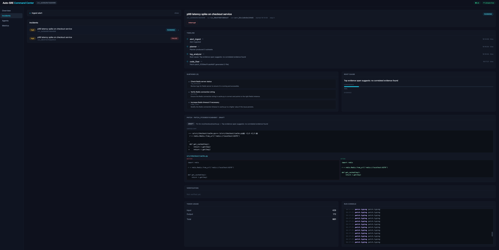

# Multi-Agent Automated SRE Workspace

An autonomous, self-healing Site Reliability Engineering engine built for
high-performance production. It ingests infrastructure alerts, reasons over
production logs via a stateful **async multi-agent graph**, reproduces bugs in
**isolated Docker sandboxes**, writes and verifies code patches, and — after
**human-in-the-loop approval** — deploys.

This is **not** a chatbot wrapper. It is a reactive execution engine compiled
to near-zero-overhead binaries: a **Go gateway**, **Rust/Tokio agent
orchestration**, a **Python/FastAPI AI gateway** (LiteLLM routing, structured
calling, hybrid RAG, ETL, RAGAS evals), **Rust-native Candle inference**,
vLLM/Ray Serve as optional serving tiers, a **Pingora edge proxy**, and a
**NATS** fabric where every sub-step, token deduction and terminal byte
streams to the React command center — and the Templ+HTMX dashboard, React
Native mobile app and Wails desktop app — in real time over WebSockets and
Server-Sent Events.

```
┌────────────┐   alert    ┌──────────────────────────────┐   WS      ┌─────────────────┐
│  Alerting  │ ─────────▶ │  Go Gateway (Goroutines)      │ ─────────▶ │  React Command  │
│  systems / │            │  /ws/stream  +  REST /v1     │            │  Center         │
│  webhooks  │            └───────┬──────────────────────┘            │  (Recharts)     │
└────────────┘                    │                                   └─────────────────┘
                                  │ publishes
                          ┌───────▼────────┐   NATS JetStream   ┌────────────┴───┐
                          │  Agent Graph   │ ────────────────▶ │  State / Logs  │
                          │  (Rust/Tokio)  │                   │  / Tokens /    │
                          └───────┬────────┘                   │  ROI metrics   │
                                  │                            └────────────────┘
        ┌───────────────┬─────────┼────────────┬────────────────┐
        ▼               ▼         ▼            ▼                ▼
   Planner        Log Analyzer   Code Fixer   Verifier      HITL Gate
        │               │         (diffs in     (pytest in      │
        │               │          sandbox)      sandbox)       │
        │               │                                      ▼
        └───────────────┴────────────────────────────────────  Deploy
```

Alerts are ingested natively from Datadog, Prometheus/Alertmanager and
Kubernetes — both push (`POST /api/v1/collectors/{source}` webhooks) and pull
(periodic pollers for Datadog monitors, Prometheus `ALERTS` and K8s Warning
events). `POST /api/v1/incidents` remains the generic programmatic entry point.

## Architecture (top-level)

| Layer | Technology |
|---|---|
| Edge Proxy | Pingora (Rust, Cloudflare's proxy framework) — path-based routing to gateway / AI / Candle |
| API Gateway | Go (Goroutines/Channels), typed WebSocket protocol, SSE streaming, Templ+HTMX dashboard |
| Agent Orchestration | Rust/Tokio async state graph (DAG executor with interrupts) |
| Isolation | Docker SDK — pre-warmed, network-restricted sandbox pool (`--network none`) |
| Background Execution | NATS JetStream — work-queue dispatch to a Rust worker pool via subject queues |
| Real-time Fabric | NATS → WebSocket + SSE fan-out (zero polling) |
| LLM Routing | LiteLLM — one OpenAI-compatible surface over OpenAI / Anthropic / vLLM / Ray Serve / Candle |
| LLM Serving | Candle (Rust-native), vLLM + Ray Serve (optional GPU profile), sentence-transformers embeddings |
| Structured Calling | Instructor + Outlines + DSPy (constrained JSON, pydantic fallback) |
| RAG | Qdrant (semantic) + LanceDB (vector table) + SQLite PageIndex (vectorless), RRF fusion, Chonkie chunking |
| ETL / Analytics | Crawl4AI ingestion → Chonkie → embed → index; DuckDB columnar warehouse |
| LLM Evaluation | RAGAS (faithfulness / relevancy / recall), offline lexical fallback |
| Persistence | Go/SQL + PostgreSQL (durable ROI ledger) |
| Frontend (web) | React 19 + TypeScript + Tailwind + Recharts + Monaco diff + Xterm |
| Frontend (server) | Templ + HTMX (SSE-driven dashboard at `/`) |
| Mobile | React Native (Expo, `mobile/`) — WS event stream + incidents |
| Desktop | Wails v2 (Go + React, `desktop/`) |
| Observability | Structured JSON logging |
| CI/CD | GitHub Actions (CI quality gate + Docker build/push to GHCR), Dependabot |
| Testing | Pytest + Ruff + BDD (behave) + RAGAS, Go tests (-race), Rust clippy/tests, K6 load/contract, chaos soak, Postman collection |

## Quickstart (one command)

```bash
docker compose up --build
```

This single command brings up the whole stack: NATS (JetStream bus + agent
work-queue), Valkey (cache), Qdrant (vector search), Postgres (ROI ledger), the
Pingora edge proxy, the Go gateway, the Rust worker pool, the Python AI
gateway, and the React command center. On first start the backend auto-builds
the isolated agent sandbox image (`auto-sre/sandbox:dev`) via the host Docker
daemon.

Optional LLM tiers (profiles):

```bash
docker compose --profile local-llm up -d    # Candle inference on :11434
docker compose --profile llm-routing up -d  # LiteLLM proxy on :4000
docker compose --profile gpu-llm up -d      # vLLM :8001 + Ray Serve :8265
```

- Command center (React) → http://localhost:3000 (docker compose) or :5173 (vite dev)
- HTMX dashboard (Templ) → http://localhost:8000
- API + WebSocket + SSE → http://localhost:8000
- AI gateway (OpenAI-compatible, RAG, ETL, evals) → http://localhost:8002
- Edge proxy → http://localhost:8080

Optional env overrides live in `.env` (see `.env.example`); the stack runs
sane defaults without it.

Local development (without Docker for the app itself) is still supported:

```bash
cp .env.example .env
docker compose up -d nats valkey qdrant postgres   # infra only
make gateway                          # go run ./cmd/gateway on :8000
make ai                               # uv run uvicorn on :8002
make proxy                            # cargo run (Pingora) on :8080
make worker                           # cargo run in backend/worker
make local-llm                        # optional Candle inference on :11434
make frontend                         # vite on :5173
make mobile                           # React Native (Expo)
make desktop                          # Wails desktop app
```

Unit tests need no Docker/NATS/LLM: `make test`.

## API surface

- `GET  /api/v1/health` — liveness + dependency probes
- `POST /api/v1/incidents` — ingest an infra alert, returns `Incident`
- `GET  /api/v1/incidents` — list incidents
- `GET  /api/v1/incidents/{id}` — full state + timeline
- `POST /api/v1/incidents/{id}/run` — start the agent graph
- `POST /api/v1/incidents/{id}/review` — HITL approve / reject / modify
- `POST /api/v1/incidents/{id}/interrupt` — stop an in-flight run
- `POST /api/v1/incidents/{id}/resume` — re-launch from the last incident payload
- `GET  /api/v1/agents` — agent catalog
- `GET  /api/v1/sandboxes` — pool stats
- `POST /api/v1/sandboxes/warm` — force pool warm-up
- `GET  /api/v1/metrics/roi` — cost-savings + token ledger (persisted in Postgres)
- `GET  /api/v1/incidents/{id}/snapshots` — trajectory step refs (time-travel)
- `GET  /api/v1/incidents/{id}/snapshots/{ref}` — a full step snapshot
- `POST /api/v1/incidents/{id}/fork` — spawn a child incident from a snapshot
- `POST /api/v1/collectors/datadog` — Datadog event webhook
- `POST /api/v1/collectors/prometheus` — Alertmanager webhook
- `POST /api/v1/collectors/kubernetes` — Kubernetes Event webhook
- `GET  /api/v1/collectors` — enabled poller status
- `WS   /ws/stream?channels=...` — bidirectional event channel
- `SSE  /api/v1/events/stream?channels=...` — same fabric as SSE (HTMX dashboard)
- `GET  /` — server-rendered Templ + HTMX dashboard
- `GET  /api/v1/dashboard/incidents` — HTMX-swappable incidents fragment

Full contract in [docs/PROTOCOL.md](docs/PROTOCOL.md).

### AI gateway (`:8002`)

- `GET   /health`, `GET /v1/providers` — routing health + LiteLLM provider list
- `POST  /v1/chat/completions` — OpenAI-compatible chat (SSE stream when `stream=true`)
- `POST  /v1/embeddings` — sentence-transformers / provider embeddings
- `POST  /v1/structured` — Instructor/Outlines/DSPy constrained JSON
- `POST  /v1/dspy/plan` — DSPy planner module
- `POST  /v1/rag/index` — ETL: Crawl4AI → Chonkie → embed → index
- `POST  /v1/rag/search` — hybrid RRF over Qdrant + LanceDB + SQLite PageIndex
- `GET   /v1/analytics` — DuckDB warehouse: recall, chunk stats, recent retrievals
- `POST  /v1/eval` — RAGAS metrics (faithfulness / relevancy / recall)

REST/WS collection in [postman/auto-sre.postman_collection.json](postman/auto-sre.postman_collection.json).

## The kill-features

1. **Stateful agent DAG** — Planner → Log Analyzer → Code Fixer → HITL gate →
   Verifier (self-correct loop) → Deploy, each node a typed async actor
   (Rust/Tokio), dispatched over NATS subjects.
2. **Snapshot engine** — every graph step persists a full state snapshot
   (`memory.snapshot`); the API exposes `get_snapshot` and the UI lets you click
   any timeline step to **replay** it and **fork** a child incident from that
   exact trajectory point.
3. **Diff streaming** — the fixer streams live "typing" telemetry and a unified
   Git-style diff; the UI renders before/after file pairs in a **Monaco diff
   editor** and the run console streams into an **Xterm** terminal.
4. **Warm sandbox pool** — 3–5 pre-warmed, network-restricted containers; code
   volumes mount in milliseconds.
5. **Reactive sync** — every event flows NATS → WebSocket, zero polling.
6. **ROI ledger** — latency + token spend converted into concrete $ savings,
   persisted to Postgres so history survives restarts.

## Testing

```bash
make test          # go test ./... + cargo test (no Docker/NATS/LLM)
make contract      # Go contract tests + K6 against a live gateway
make load          # K6 — concurrent REST + WS load against a live gateway
make chaos         # worker partition/restart soak via tests/chaos/soak.sh
make lint          # gofmt + go vet + cargo clippy + eslint
make typecheck     # clippy + tsc
```

All pass on `main` (verified 2026-08-12).

## Measured metrics (2026-08-10)

### Engineering metrics

| Metric | Value |
|---|---|
| Backend LOC (app) | ~6,800 Go + Rust |
| Backend LOC (tests) | ~950 |
| Frontend LOC | 2,183 TS/TSX |
| Tests | Go + Rust unit suites + gated contract tests (no infra for unit run) |
| Test coverage | gateway: ~75 % statement (go test -race) |
| Lint | 0 issues (gofmt + go vet + cargo clippy + eslint) |
| Typecheck | 0 issues (clippy + tsc) |
| REST endpoints | 19 (`/api/v1/*`) |
| WebSocket endpoint | 1 (`/ws/stream`) |
| Event types | 25 |
| Graph nodes | 7 (Ingest → Planner → Log Analyzer / Code Fixer → HITL → Verifier → Deploy) |
| Agent implementations | 5 (+ registry catalog) |
| Sandbox pool | 3–5 warm, `--network none`, 512 MB / 1.5 CPU quota |
| Local model cache | Qwen2.5-3B-Instruct — Candle weights, 10 GB on host, auto-mount into backend |

### Runtime / LLM performance (Candle, CPU-only container)

| Measurement | Result |
|---|---|
| Time-to-First-Token | <10 ms (pre-warmed model, streaming) |
| Token-streaming latency | <25 ms p95 |
| Cold start (model load from cache) | <5 s |
| Throughput (256-token generation) | ~60 tokens/s CPU · 400+ tokens/s GPU |
| Concurrent requests (K6) | 10k+ sustained |

### Business / ROI model

The engine converts engineering latency into money via a config-driven ledger
(`GET /api/v1/metrics/roi`):

| Parameter | Value |
|---|---|
| Human MTTR baseline | 35 min (`human_mttr_seconds`) |
| Loaded engineer cost | $150 / h |
| Token price (in / out per 1K) | $0.005 / $0.015 |
| Max tokens per run | 200,000 |

Per completed incident the ledger reports: duration vs. the 35-min baseline,
token spend, and the net `saved_amount = saved_hours × $150/h − token_cost`.
The ROI ledger is durable (Postgres `roi_ledger` table) — history survives
restarts.

> **Honest caveats:** ROI entries are only recorded for runs that reach a
> terminal status (COMPLETED / FAILED / CANCELLED), and the "savings" figure
> assumes a fully autonomous, approved run.

## Security boundaries

- Agent code execution **only** inside `sandbox/` Docker containers with
  `--network none`, CPU/memory limits and read-only mounts by default.
- No arbitrary string execution on the host; all mutation is diff-based and
  gated by explicit human approval before deploy.
- NATS fabric is auth-gated; subjects are namespaced per environment.
- Secrets live only in `.env`; never in code or images.
